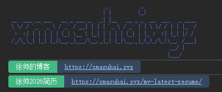

# vite-plugin-console-banner

在浏览器控制台打印 figlet ASCII Art 横幅和链接标签的 Vite 插件。

字体在构建阶段按配置动态加载，生成的文本被注入 `index.html`。浏览器不依赖 figlet，也不会打包 `.flf` 字体文件。开发和生产构建都会注入。

## 示例样式



## 安装

```bash
pnpm add -D vite-plugin-console-banner
```

`vite` 和 `figlet` 是 peer dependency。`figlet` 也是本包的依赖，字体文件会随安装提供，一般不需要再单独安装。

## 使用

```ts
import { defineConfig } from "vite";
import { consoleBanner } from "vite-plugin-console-banner";

export default defineConfig({
  plugins: [
    consoleBanner({
      enable: process.env.NODE_ENV === "production", // 自定义开启时机（支持 boolean 或函数）
      text: "xmasuhai.xyz",
      font: "big", // 大小写不敏感，也可用 "Big"、"ANSI Shadow"
      color: "#476EE3",
      badges: [
        { label: "徐帅的博客", url: "https://xmasuhai.xyz" },
        { label: "徐帅${year}简历", url: "https://xmasuhai.xyz/my-latest-resume/" },
      ],
    }),
  ],
});
```

## 选项

| 选项               | 类型                                             | 默认值          | 说明                                     |
|--------------------|--------------------------------------------------|-----------------|------------------------------------------|
| `enable`           | `boolean \| (() => boolean \| Promise<boolean>)` | `true`          | 是否启用横幅，支持布尔值或函数以自定义展示时机 |
| `text`             | `string`                                         | `"Hello"`       | ASCII Art 文本                           |
| `font`             | `string`                                         | `"ANSI Shadow"` | figlet 内置字体名，大小写不敏感          |
| `color`            | `string`                                         | `"#476EE3"`     | ASCII Art 的 CSS 颜色                    |
| `badges`           | `Badge[]`                                        | `[]`            | 横幅下方的控制台标签                     |
| `badges[].label`   | `string`                                         | -               | 标签文字，`${year}` 会替换为构建时的年份 |
| `badges[].url`     | `string`                                         | -               | 标签链接                                 |
| `badges[].labelBg` | `string`                                         | `"#42b883"`     | 标签背景色                               |
| `badges[].urlBg`   | `string`                                         | `"#35495e"`     | 链接背景色                               |

字体名对应 figlet 包内 `fonts/*.flf` 的文件名（去掉扩展名）。未知字体会在构建期抛出错误，不会静默回退到默认字体。

## 灵感

- [vite-plugin-figlet](https://github.com/leifarriens/vite-plugin-figlet)
- See all [configurable options](https://github.com/DefinitelyTyped/DefinitelyTyped/blob/master/types/figlet/index.d.ts).

## 许可

[MIT](./LICENSE) License &copy; 2026-PRESENT [xmasuhai](https://github.com/xmasuhai)

---

## 发布流程

### 1. 脚本自动发布（推荐）

- 通过 [`scripts/publish.mjs`](./scripts/publish.mjs) 自动执行
  - **Git 工作区检查 → 临时切换 npm 官方源 → 登录态验证 → 构建与测试 → 默认升级补丁版本（`patch`）→ 发布 npm 包 → 自动恢复原镜像源**：

```bash
# 演练预检（校验构建、测试与打包清单，不修改版本号、不实际发布）
pnpm run release:dry

# 默认升级补丁版本（patch）并发布
pnpm run release

# 指定版本升级类型、自动推送 Git 标签或传入 2FA 验证码
node scripts/publish.mjs minor --push
node scripts/publish.mjs patch --otp=123456
```

> 也可参考 [`prompts/publish-npm.md`](./prompts/publish-npm.md) 提示词，借助 AI 助手按步骤引导发布。

### 2. 手动发布步骤

1. **检查工作区与校验**：确保所有 Git 变更已提交，执行 `pnpm run build && pnpm run test`。
2. **临时切换 npm 官方源并验证登录**：

```bash
npm config get registry
npm config set registry https://registry.npmjs.org/ # 或 nrm use npm
npm login # 已登录可通过 npm whoami 验证
```

3. **升级版本号并发布**：

```bash
# patch（补丁 0.1.0 -> 0.1.1）| minor（次版本 0.1.0 -> 0.2.0）| major（主版本 0.1.0 -> 1.0.0）
npm version patch
npm publish
```

4. **恢复镜像源并推送代码**：

```bash
npm config set registry https://registry.npmmirror.com/ # 或 nrm use taobao
git push && git push --tags
```

---
---
